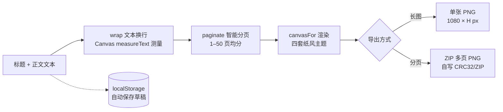

# 长图 · 文字排版（Long Text · Image Layout）

> 一个**纯前端、零依赖、零构建**的单文件工具：把长文本变成干净、可分享的图文。  
> 支持长图导出（PNG）与分页导出（ZIP），四套纸风主题、中英双语、纯本地处理。


---

## 一、这是什么

`index.html` 是一个**单文件网页应用**，打开即用，不需要安装任何东西、不需要联网、不需要服务器。  
你输入标题和正文，它在浏览器里实时排版并渲染成图片，可一键导出：

- **长图（Long Image）**：把整段文字排成一张高分辨率竖图（宽 1080px，高度自适应，上限 30000px）；
- **分页（Pages）**：按你设定的 1–50 页智能均分，逐页导出 PNG，并打包成一个 ZIP；
- **TXT 导入**：直接拖入/选择 `.txt` 文件，自动填充正文；
- **四套纸风主题**：白栀（Gardenia）/ 夜墨（Night Ink）/ 旧书（Old Book）/ 雾蓝（Mist Blue）；
- **字号 / 行距 / 页脚** 可调；
- **中英双语**界面（自动按浏览器语言，也可手动切换）；
- **纯本地**：所有处理在浏览器内完成，`localStorage` 自动保存草稿，**内容不会上传到任何服务器**。

> 原文件名 `v2_wubiaoti_paiban.html`，开源版本统一命名为 `index.html`（便于 GitHub Pages 直接托管）。

---

## 二、界面与数据流

工具的处理链路如下（全部在浏览器本地完成）：



页面布局为左侧编辑器、右侧实时预览（长图视图 / 分页视图可切换）：

| 区域    | 功能                        |
| ----- | ------------------------- |
| 顶栏    | 语言切换、导入 TXT、导出 ZIP、导出长图   |
| 左侧编辑器 | 标题、正文、纸风主题、字号、行距、分页数量、左页脚 |
| 右侧预览  | 实时长图 / 分页预览，可逐页翻看、单独下载当前页 |

---

## 三、怎么用

### 方式 A：直接打开（最简单）

双击 `index.html`，或拖进任意现代浏览器（Chrome / Edge / Firefox / Safari）即可使用。

### 方式 B：本地起一个服务（推荐，避免个别浏览器对 `file://` 的限制）

```bash
# 在项目目录内任选其一
python3 -m http.server 8000
# 然后浏览器访问 http://localhost:8000
```

### 方式 C：在线使用（部署后）

把本仓库开启 **GitHub Pages** 后即可获得一个公开链接，任何人都能在线使用。  
详见 [GITHUB\_UPLOAD\_GUIDE.md](./GITHUB_UPLOAD_GUIDE.md)。

---

## 四、技术亮点

- **纯前端单文件**：HTML + CSS + 原生 JavaScript 全部内联在一个文件里，零第三方库、零构建步骤。
- **Canvas 高分辨率渲染**：以 1080px 宽为基准绘制，长图高度自适应（上限 `MAX_LONG_HEIGHT = 30000px`）。
- **自实现轻量 ZIP 打包**：`makeZip()` 用纯 JS 实现 CRC32 校验与 ZIP 文件格式，无需任何压缩库即可导出多页 ZIP。
- **智能分页算法**：`paginate()` 对标题块占位做行数补偿（`T` 行），保证各页正文底部对齐、无空页、无漏页。
- **中英文混排 + 标点避头尾**：`wrap()` 内置 `noStart`/`noEnd` 规则，避免逗号、句号、括号等出现在行首/行尾。
- **隐私优先**：纯本地处理，内容不上传；开源版本已移除原版内嵌的第三方访问统计脚本（见下一节）。

---

## 五、隐私与数据说明

- 本工具**全程在浏览器本地运行**，正文、标题、页脚等所有输入只保存在你自己的浏览器 `localStorage` 中，**不会发送到任何服务器**。
- 原版 `v2_wubiaoti_paiban.html` 内嵌了一个第三方访问统计脚本（goatcounter，指向原作者账号 `tupetetodou.goatcounter.com`）。  
  **开源版本已将其移除**，因为把访问者数据发到第三方账号不符合开源隐私规范。  
  如需自行统计，请到 <https://www.goatcounter.com> 注册你自己的账号，并按 `index.html` 中注释的示例自行启用。

---

## 六、项目结构

```
changtu-text-image/
├── index.html              # 应用本体（单文件，已移除第三方统计脚本）
├── LICENSE                 # GPL-3.0 许可证全文
├── README.md               # 本文件：项目说明
├── GITHUB_UPLOAD_GUIDE.md  # 详细的 GitHub 开源上传方案
├── CONTRIBUTING.md         # 贡献指南
├── CHANGELOG.md            # 版本变更记录
└── .gitignore              # Git 忽略规则
```

---

## 七、许可证

本项目以 **GNU General Public License v3.0（GPL-3.0）** 开源。

- 你可以在遵守 GPL-3.0 条款的前提下自由使用、修改、再分发；
- 基于本项目修改或衍生的作品**也必须以 GPL-3.0 开源**；
- 完整条款见 [LICENSE](./LICENSE)。

> 版权人信息请在发布前在 `LICENSE` 与下方补充。当前仓库的版权归属由发布者自行声明。

---

## 八、如何参与贡献

欢迎提 Issue 与 Pull Request。流程与规范见 [CONTRIBUTING.md](./CONTRIBUTING.md)。  
所有贡献将默认以 GPL-3.0 许可证并入本项目。

---

## 九、相关文档

- [GitHub 开源上传详细方案](./GITHUB_UPLOAD_GUIDE.md) —— 从建仓、上传到开启 Pages 与打 Release 的完整步骤。

---

## 十、参考与来源

- **GNU General Public License v3.0 官方文本**：<https://www.gnu.org/licenses/gpl-3.0.txt>（已下载全文保存为 `LICENSE`）。原文语句：*"GNU GENERAL PUBLIC LICENSE — Version 3, 29 June 2007"*。
- **goatcounter 统计脚本移除**：基于对 `index.html` 源码中原内嵌第三方向量统计脚本（指向 `tupetetodou.goatcounter.com`）的分析，依据开源隐私合规判断移除。推理结论（源码分析 + 隐私规范判断）。
- 本 README 的功能说明与数据流图（Mermaid），均来自对 `index.html` 源码 `wrap` / `paginate` / `canvasFor` / `makeZip` 等函数的实际阅读，图中节点与连线对应真实代码链路。推理结论（源码分析）。
